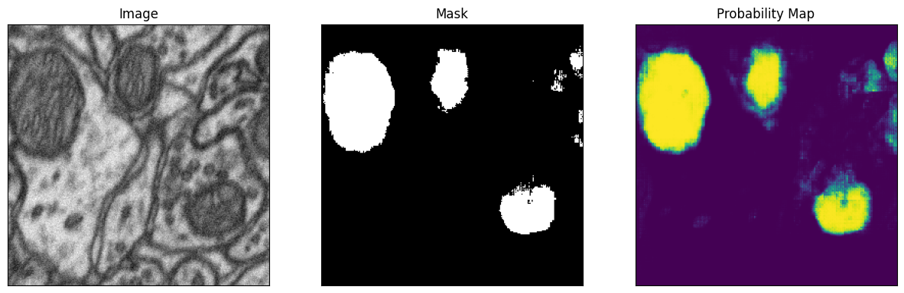

# MitoSAM

**Fine-tuning Meta's Segment Anything Model (SAM) to segment mitochondria in electron microscopy images.**



MitoSAM adapts the general-purpose [Segment Anything Model](https://github.com/facebookresearch/segment-anything) to one narrow biomedical task: segmenting mitochondria in electron microscopy (EM) images. Instead of starting from a medical variant like MedSAM, it fine-tunes the original `sam-vit-base` checkpoint on a small annotated dataset. The result is a lightweight, specialised "mini-MedSAM". It shows that a foundation model can be repurposed for a complex biomedical problem with limited labelled data.

---

## How it works

1. **Load data.** A TIFF stack of 165 EM images (768x1024) and their binary ground-truth masks.
2. **Patchify.** Each image is split into non-overlapping 256x256 patches with [`patchify`](https://pypi.org/project/patchify/), which yields 1,980 patches. This reduces memory use and gives more training examples.
3. **Filter.** Patches with empty masks are removed, which leaves 1,642 image/mask pairs. Empty masks can break the loss computation.
4. **Prompt generation.** A bounding box is computed from each ground-truth mask and randomly perturbed by 0-20 px. This box is the prompt given to SAM.
5. **Fine-tune.** The vision encoder and prompt encoder are frozen. Only the **mask decoder** is trained.
6. **Inference.** The model takes an image and a box prompt, and outputs a probability map. Thresholding the map at 0.5 gives the binary mask.

## Training setup

| Setting | Value |
|---|---|
| Base model | `facebook/sam-vit-base` (Hugging Face Transformers) |
| Trainable part | Mask decoder only |
| Loss | `monai.losses.DiceCELoss` (sigmoid, squared_pred) |
| Optimizer | Adam, lr = 1e-5, weight decay = 0 |
| Batch size | 2 |
| Epochs | 1 (increase for better results) |
| Input patch size | 256x256 |
| Prompt | Perturbed bounding box from the ground-truth mask |

## Repository contents

```
MedSAM_for_Mitochondria_Segmentation.ipynb   # Full pipeline: data prep, training, inference
README.md
```

## Getting started

The notebook is written for **Google Colab with a GPU runtime**.

### 1. Install dependencies

```bash
pip install git+https://github.com/facebookresearch/segment-anything.git
pip install git+https://github.com/huggingface/transformers.git
pip install datasets monai patchify tifffile
```

### 2. Prepare the data

The notebook expects two multi-page TIFF files:

```
data_mip/
├── images/training.tif               # stack of EM images
└── masks/training_groundtruth.tif    # matching binary masks (0 / 255)
```

By default it reads them from Google Drive (`/content/drive/MyDrive/data_mip/`). Change the paths in the loading cell if your data is somewhere else.

### 3. Run the notebook

Open `MedSAM_for_Mitochondria_Segmentation.ipynb` and run all cells. The fine-tuned weights are saved to:

```
/content/drive/MyDrive/data_mip/model_checkpoint.pth
```

### 4. Run inference with the saved model

```python
from transformers import SamModel, SamConfig, SamProcessor
import torch

config = SamConfig.from_pretrained("facebook/sam-vit-base")
processor = SamProcessor.from_pretrained("facebook/sam-vit-base")

model = SamModel(config=config)
model.load_state_dict(torch.load("model_checkpoint.pth"))
model.to("cuda").eval()

inputs = processor(image, input_boxes=[[box]], return_tensors="pt").to("cuda")
with torch.no_grad():
    outputs = model(**inputs, multimask_output=False)

prob_map = torch.sigmoid(outputs.pred_masks.squeeze(1)).cpu().numpy().squeeze()
mask = (prob_map > 0.5).astype("uint8")
```

The notebook shows each prediction as three panels side by side: the input image, the binary mask, and the probability map.

## Limitations and next steps

- **Box prompts depend on ground truth.** During training and the demo, boxes come from the true masks. Real use would need boxes from a user, a detector, or a grid-of-points strategy.
- **Short training.** One epoch is a proof of concept. Longer training, a validation split, and metrics such as Dice and IoU would make the results more solid.
- **Patch-level only.** Predictions are made per 256x256 patch. Stitching them back into full-size images is not implemented yet.
- **No augmentation.** Flips, rotations, and intensity jitter could help the model generalise.

## Acknowledgements

The pipeline is adapted from Niels Rogge's tutorial [Fine-tune SAM (Segment Anything) on a custom dataset](https://github.com/NielsRogge/Transformers-Tutorials/blob/master/SAM/Fine_tune_SAM_(segment_anything)_on_a_custom_dataset.ipynb). It was reworked to train on a real custom dataset of images and binary masks.

Built on [Segment Anything](https://github.com/facebookresearch/segment-anything) (Meta AI), [Hugging Face Transformers](https://github.com/huggingface/transformers), and [MONAI](https://monai.io/).
